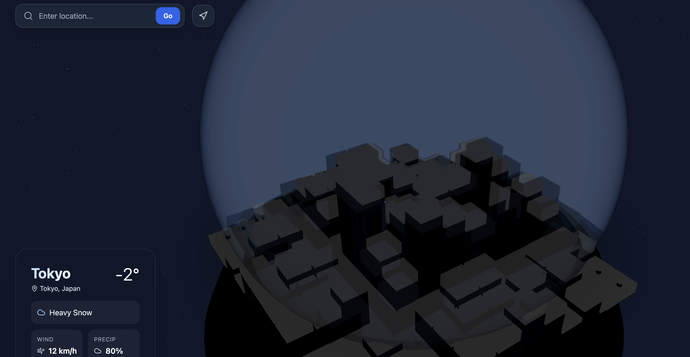
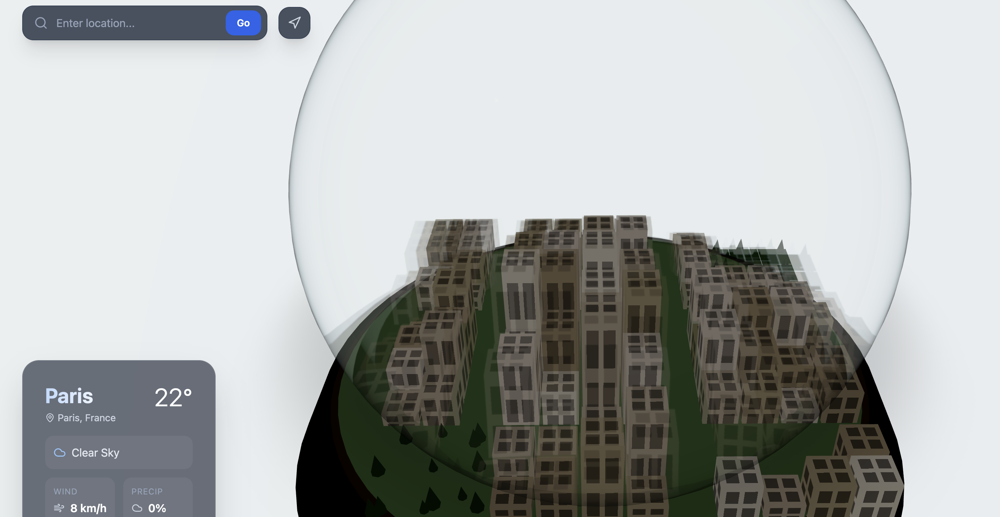

# IsoGlobe Weather



A 3D snow globe that visualizes **real-time weather** for any location on Earth. Type a city, and Gemini AI fetches live conditions, generates a unique isometric cityscape, and renders it inside a Three.js glass dome — complete with dynamic weather particles, day/night cycles, and a **SHAKE GLOBE** button.

## Quick Start

```bash
git clone https://github.com/andrewvoirol/ais-isoglobe-weather.git
cd ais-isoglobe-weather
npm install
```

Create `.env.local` with your [Gemini API key](https://aistudio.google.com/apikey):

```
VITE_GEMINI_API_KEY=your_key_here
```

```bash
npm run dev
```

> Runs on `http://localhost:3000`. Works without an API key too — falls back to a default Paris scene.

## How It Works

1. **Search any location** — type a city name or use the GPS button for your current coordinates
2. **Watch it build** — Gemini fetches live weather via Google Search, then generates a 12×12 isometric city grid with location-appropriate architecture and colors
3. **Explore the globe** — orbit, zoom, and drag the 3D scene. Day/night lighting, stars, sky, and weather particles all respond to real conditions
4. **Shake it** — hit the SHAKE GLOBE button to agitate the snow/rain particles

### Under the Hood

Two-step Gemini 2.5 Flash pipeline:
1. **Google Search Grounding** → fetches current weather data with source citations
2. **Structured JSON generation** → produces the city layout, color palette, and parsed weather parameters from the grounding response

The structured response feeds directly into a Three.js scene with procedural buildings (window textures, seeded colors), parks with trees, water features, roads, and a physically simulated particle system for snow/rain.

## Screenshots

| Daytime — Paris, Clear Sky | Nighttime — Tokyo, Heavy Snow |
|:---:|:---:|
|  |  |

## Tech Stack

| Layer | Technology |
|-------|-----------|
| Framework | React 19 |
| 3D Engine | Three.js + React Three Fiber + Drei |
| AI | Gemini 2.5 Flash (`@google/genai`) |
| Styling | Tailwind CSS 3 |
| Bundler | Vite 6 |
| Icons | Lucide React |
| Language | TypeScript 5.8 |

## Features

- 🌍 **Live weather** for any location via Google Search Grounding
- 🏙️ **Procedural cities** — unique 12×12 isometric grids generated per search
- 🌙 **Day/night cycles** — dynamic sky, stars, ambient lighting, window glow
- ❄️ **Weather particles** — snow, rain, wind turbulence with building collision
- ☃️ **Snow accumulation** — rooftops, ground, and tree caps build up over time
- 🫧 **Glass dome** — physically-based transparency, clearcoat, tinted refraction
- 🔗 **Source citations** — grounded search results linked in the info card
- 📍 **Geolocation** — one-tap GPS coordinates
- 🤝 **Graceful fallback** — works offline with a default Paris scene
